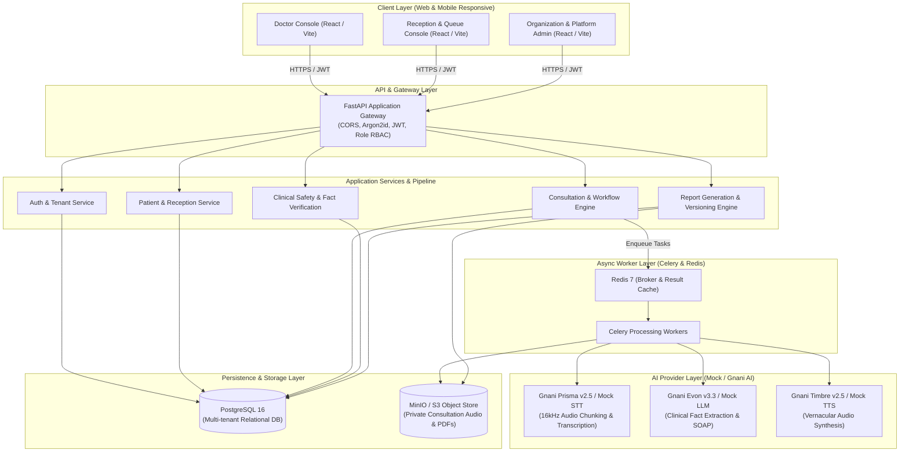

# ArogyaScribe — High-Level Design (HLD)

## 1. System Vision & Problem Statement

**ArogyaScribe** is a B2B Healthcare Software-as-a-Service (SaaS) platform tailored for Indian outpatient clinics, polyclinics, and multi-specialty healthcare networks. It streamlines clinical documentation by recording doctor-patient consultations (with mandatory patient consent), transcribing multi-lingual Indian speech (Hinglish, Hindi, English, regional dialects), extracting structured clinical facts with audit-traceable evidence grounding, and drafting two distinct clinical deliverables:
1. **Clinician Encounter Note:** Structured clinical documentation (SOAP format, ICD-10/SNOMED coding, vitals, diagnosis, prescriptions).
2. **Patient Summary & Audio:** Patient-friendly instruction sheet in vernacular language along with synthesized voice narration for accessibility.

---

## 2. Core Architecture Tenets

1. **4 Roles Only — Zero Patient Login:**
   - Platform users comprise four strict roles: `PLATFORM_OWNER` (Super Admin), `ORG_ADMIN` (Clinic/Hospital Administrator), `RECEPTIONIST` (Front-desk operations), and `DOCTOR` (Consulting Clinician).
   - Patients are strictly administrative and clinical records. **Patients do not have accounts, passwords, or portals.** Summaries are shared securely via ephemeral WhatsApp links or printable summaries without patient credential overhead.
2. **Strict Multi-Tenant Isolation:**
   - Every clinical record, consultation, user membership, and asset is partitioned by `organization_id`. Cross-tenant queries are blocked at both database and application query boundaries.
3. **Clinical Safety & Non-Negotiable Human-in-the-Loop:**
   - AI outputs are strictly treated as **AI DRAFT** recommendations.
   - Clinical facts cannot be approved if medication details (dose, frequency, duration) are incomplete.
   - Clinician edits never alter historical evidence grounding; reports require explicit cryptographic sign-off (`content_sha256`).
4. **Resilient Dual-Mode AI Pipeline:**
   - Plug-and-play architecture supporting local, deterministic mock adapters for instant zero-dependency local development, alongside production adapters for **Gnani AI** (`Prisma v2.5` STT, `Evon v3.3` Clinical LLM, and `Timbre v2.5` TTS).

---

## 3. High-Level Architecture Diagram



---

## 4. Multi-Tenant Role Hierarchy

A single instance supports multiple independent organizations (e.g., Hospital A, Clinic B).

```text
PLATFORM_OWNER (Super Admin)
  └── Global platform configuration, subscription billing plans, telemetry
        │
        ├── Organization A (Multi-Specialty Hospital)
        │     ├── Location 1 (Main Campus)
        │     │     ├── ORG_ADMIN (Medical Superintendent)
        │     │     ├── RECEPTIONIST (Front-Desk Officer)
        │     │     └── DOCTOR (General Physician / Specialist)
        │     └── Location 2 (Satellite Clinic)
        │
        └── Organization B (Single Doctor Clinic)
              └── ORG_ADMIN / DOCTOR
```

### Role Capabilities Matrix

| Role | Scope | Permissions |
|---|---|---|
| `PLATFORM_OWNER` | System-wide | View all tenants, configure plans, monitor system health & AI adapters. |
| `ORG_ADMIN` | Organization-wide | Manage locations, staff users, subscription & billing, clinical templates. |
| `RECEPTIONIST` | Location-wide | Patient registration, appointment scheduling, queue management, consent verification. |
| `DOCTOR` | Location / Assigned Encounters | Consultation recording, live review of extracted clinical facts, doctor note approval, patient summary generation. |
| *(Patient)* | **No Login** | Receives paper or WhatsApp summary; has zero platform authentication privileges. |

---

## 5. End-to-End Clinical Documentation Flow

1. **Patient Check-in & Consent:** Receptionist registers the patient, books an appointment, and verifies/records explicit audio recording consent.
2. **Audio Capture:** Doctor starts consultation. Client records 16 kHz mono WAV chunks or accepts clean uploads. The API refuses audio upload if consent is not recorded.
3. **Speech-to-Text (`Prisma v2.5`):** Audio chunks are ingested, transcribed in sequence, and normalized with speaker labels and millisecond offsets.
4. **Clinical Fact Extraction (`Evon v3.3`):** AI extracts structured facts (symptoms, diagnoses, medications, instructions) with precise evidence pointers referencing transcript segments.
5. **Safety Verification Engine:** Medications missing dosage, frequency, or duration are marked `unresolved` and block report approval until explicitly completed or rejected by the clinician.
6. **Dual-Report Drafting:** System drafts Doctor Encounter Note (SOAP format) and Patient Vernacular Summary.
7. **Clinician Review & Approval:** Doctor verifies facts, edits drafts if necessary, and signs off. Approval checks SHA-256 content hashes to eliminate race conditions.
8. **Patient Delivery (`Timbre v2.5`):** Approved patient summary generates synthesized Hindi/regional voice note, ready for direct WhatsApp dispatch from the doctor's phone.

