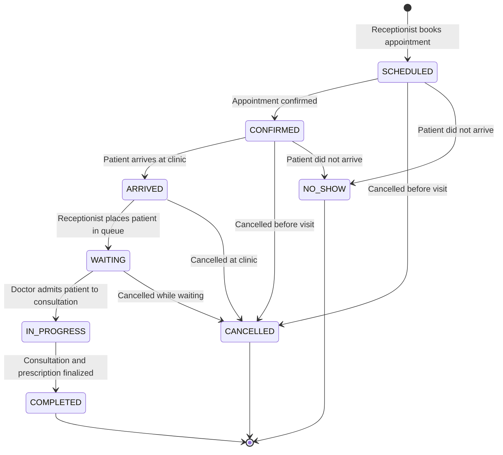

# ArogyaScribe — Low-Level Design (LLD)

## 1. Relational Database Schema (PostgreSQL 16)

All tables use UUID v4 primary keys (`id`) and include automatic `created_at` and `updated_at` timestamps via `TimestampUUIDMixin`. Multi-tenant tables include indexed `organization_id` foreign keys.

---

### Identity, Tenant & Access Management

#### 1. `organizations`
Stores clinic and hospital tenant definitions.
- `id`: UUID (PK)
- `name`: VARCHAR(255) NOT NULL
- `org_type`: VARCHAR(100) NOT NULL (e.g., 'POLYCLINIC', 'SINGLE_DOCTOR', 'HOSPITAL')
- `contact_email`: VARCHAR(255) NOT NULL
- `contact_phone`: VARCHAR(30) NOT NULL
- `address`: TEXT
- `registration_number`: VARCHAR(100)
- `status`: VARCHAR(50) DEFAULT 'ACTIVE' NOT NULL (`ACTIVE`, `SUSPENDED`, `PENDING`, `DEACTIVATED`)
- `settings_json`: JSONB DEFAULT '{}' NOT NULL
- `created_at`, `updated_at`: TIMESTAMPTZ NOT NULL

#### 2. `organization_locations`
Physical branches or facilities owned by an organization.
- `id`: UUID (PK)
- `organization_id`: UUID NOT NULL REFERENCES `organizations(id)` ON DELETE CASCADE
- `name`: VARCHAR(255) NOT NULL
- `branch_code`: VARCHAR(50) NOT NULL
- `address`: TEXT
- `phone`: VARCHAR(30)
- `is_active`: BOOLEAN DEFAULT TRUE NOT NULL
- `created_at`, `updated_at`: TIMESTAMPTZ NOT NULL
- *Unique Constraint:* `(organization_id, branch_code)`

#### 3. `users`
Authenticated staff members across the platform. Platform roles: `PLATFORM_OWNER`, `ORG_ADMIN`, `RECEPTIONIST`, `DOCTOR`.
*(Zero patient login; patients are clinical records, not users).*
- `id`: UUID (PK)
- `email`: VARCHAR(255) UNIQUE NOT NULL
- `password_hash`: VARCHAR(255) NOT NULL (Argon2id)
- `full_name`: VARCHAR(255) NOT NULL
- `phone`: VARCHAR(30)
- `is_super_admin`: BOOLEAN DEFAULT FALSE NOT NULL
- `is_active`: BOOLEAN DEFAULT TRUE NOT NULL
- `last_login_at`: TIMESTAMPTZ
- `created_at`, `updated_at`: TIMESTAMPTZ NOT NULL

#### 4. `organization_memberships`
Maps users to specific organizations with tenant-scoped roles.
- `id`: UUID (PK)
- `user_id`: UUID NOT NULL REFERENCES `users(id)` ON DELETE CASCADE
- `organization_id`: UUID NOT NULL REFERENCES `organizations(id)` ON DELETE CASCADE
- `location_id`: UUID REFERENCES `organization_locations(id)` ON DELETE SET NULL
- `role`: VARCHAR(50) NOT NULL (`ORG_ADMIN`, `RECEPTIONIST`, `DOCTOR`)
- `is_active`: BOOLEAN DEFAULT TRUE NOT NULL
- `created_at`, `updated_at`: TIMESTAMPTZ NOT NULL
- *Unique Constraint:* `(organization_id, user_id)`

#### 5. `doctor_profiles`
Clinician-specific metadata (specialization, license registration).
- `id`: UUID (PK)
- `user_id`: UUID UNIQUE NOT NULL REFERENCES `users(id)` ON DELETE CASCADE
- `organization_id`: UUID NOT NULL REFERENCES `organizations(id)` ON DELETE CASCADE
- `location_id`: UUID REFERENCES `organization_locations(id)` ON DELETE SET NULL
- `specialization`: VARCHAR(150) NOT NULL
- `qualification`: VARCHAR(255) NOT NULL
- `registration_number`: VARCHAR(100) NOT NULL
- `consultation_room`: VARCHAR(50)
- `languages_spoken`: VARCHAR(255) DEFAULT 'English, Hindi' NOT NULL
- `created_at`, `updated_at`: TIMESTAMPTZ NOT NULL

#### 6. `receptionist_profiles`
Front-desk staff metadata and primary assigned location.
- `id`: UUID (PK)
- `user_id`: UUID UNIQUE NOT NULL REFERENCES `users(id)` ON DELETE CASCADE
- `organization_id`: UUID NOT NULL REFERENCES `organizations(id)` ON DELETE CASCADE
- `location_id`: UUID REFERENCES `organization_locations(id)` ON DELETE SET NULL
- `desk_identifier`: VARCHAR(50)
- `shift_notes`: TEXT
- `created_at`, `updated_at`: TIMESTAMPTZ NOT NULL

---

### Subscription, Billing & Quota Management

#### 7. `subscription_plans`
Platform tier definitions.
- `id`: UUID (PK)
- `name`: VARCHAR(100) NOT NULL
- `code`: VARCHAR(50) UNIQUE NOT NULL (e.g., 'STARTER', 'PROFESSIONAL', 'ENTERPRISE')
- `monthly_price`: NUMERIC(10, 2) NOT NULL
- `annual_price`: NUMERIC(10, 2) NOT NULL
- `max_doctors`: INTEGER NOT NULL
- `max_receptionists`: INTEGER NOT NULL
- `max_branches`: INTEGER NOT NULL
- `monthly_consultation_limit`: INTEGER NOT NULL
- `audio_storage_mb_limit`: INTEGER NOT NULL
- `report_generation_limit`: INTEGER NOT NULL
- `included_features_json`: JSONB DEFAULT '[]' NOT NULL
- `duration_days`: INTEGER DEFAULT 30 NOT NULL
- `trial_days`: INTEGER DEFAULT 14 NOT NULL
- `is_active`: BOOLEAN DEFAULT TRUE NOT NULL
- `created_at`, `updated_at`: TIMESTAMPTZ NOT NULL

#### 8. `subscriptions`
Tenant active subscription contracts.
- `id`: UUID (PK)
- `organization_id`: UUID NOT NULL REFERENCES `organizations(id)` ON DELETE CASCADE
- `plan_id`: UUID NOT NULL REFERENCES `subscription_plans(id)`
- `status`: VARCHAR(50) DEFAULT 'TRIAL' NOT NULL (`TRIAL`, `ACTIVE`, `EXPIRED`, `SUSPENDED`, `PENDING_PAYMENT`)
- `billing_cycle`: VARCHAR(20) DEFAULT 'MONTHLY' NOT NULL (`MONTHLY`, `ANNUAL`)
- `start_date`: TIMESTAMPTZ NOT NULL
- `end_date`: TIMESTAMPTZ NOT NULL
- `auto_renew`: BOOLEAN DEFAULT TRUE NOT NULL
- `activated_by_user_id`: UUID REFERENCES `users(id)`
- `created_at`, `updated_at`: TIMESTAMPTZ NOT NULL

#### 9. `payment_transactions`
Invoice and payment receipts.
- `id`: UUID (PK)
- `organization_id`: UUID NOT NULL REFERENCES `organizations(id)` ON DELETE CASCADE
- `subscription_id`: UUID REFERENCES `subscriptions(id)` ON DELETE SET NULL
- `amount`: NUMERIC(10, 2) NOT NULL
- `currency`: VARCHAR(10) DEFAULT 'INR' NOT NULL
- `payment_mode`: VARCHAR(50) NOT NULL (`DEVELOPMENT_MANUAL`, `GATEWAY_VERIFIED`)
- `gateway_reference`: VARCHAR(255)
- `status`: VARCHAR(50) DEFAULT 'PENDING' NOT NULL (`PENDING`, `VERIFIED`, `FAILED`)
- `verified_at`: TIMESTAMPTZ
- `created_at`, `updated_at`: TIMESTAMPTZ NOT NULL

#### 10. `usage_records`
Metered billing usage tracking.
- `id`: UUID (PK)
- `organization_id`: UUID NOT NULL REFERENCES `organizations(id)` ON DELETE CASCADE
- `subscription_id`: UUID REFERENCES `subscriptions(id)` ON DELETE SET NULL
- `period_month`: VARCHAR(20) NOT NULL (e.g., '2026-11')
- `consultations_count`: INTEGER DEFAULT 0 NOT NULL
- `audio_storage_bytes_used`: BIGINT DEFAULT 0 NOT NULL
- `reports_generated_count`: INTEGER DEFAULT 0 NOT NULL
- `active_doctors_count`: INTEGER DEFAULT 0 NOT NULL
- `active_receptionists_count`: INTEGER DEFAULT 0 NOT NULL
- `active_branches_count`: INTEGER DEFAULT 0 NOT NULL
- `created_at`, `updated_at`: TIMESTAMPTZ NOT NULL
- *Unique Constraint:* `(organization_id, period_month)`

---

### Patient Administrative Records & Appointments

#### 11. `patients`
Demographic and medical record identities. (NO LOGIN credentials).
- `id`: UUID (PK)
- `organization_id`: UUID NOT NULL REFERENCES `organizations(id)` ON DELETE CASCADE
- `patient_identifier`: VARCHAR(100) NOT NULL (e.g. UHID or clinic MRN)
- `full_name`: VARCHAR(255) NOT NULL
- `date_of_birth`: DATE
- `age_years`: INTEGER
- `gender`: VARCHAR(20) NOT NULL
- `mobile_number`: VARCHAR(30) NOT NULL
- `email`: VARCHAR(255)
- `preferred_language`: VARCHAR(20) DEFAULT 'en-IN' NOT NULL
- `allergies_summary`: TEXT
- `allergy_verification_status`: VARCHAR(50) DEFAULT 'UNVERIFIED' NOT NULL
- `administrative_notes`: TEXT
- `created_at`, `updated_at`: TIMESTAMPTZ NOT NULL
- *Unique Constraint:* `(organization_id, patient_identifier)`

#### 12. `doctor_schedules`
Weekly consultation shift rosters.
- `id`: UUID (PK)
- `organization_id`: UUID NOT NULL REFERENCES `organizations(id)` ON DELETE CASCADE
- `location_id`: UUID NOT NULL REFERENCES `organization_locations(id)` ON DELETE CASCADE
- `doctor_user_id`: UUID NOT NULL REFERENCES `users(id)` ON DELETE CASCADE
- `day_of_week`: INTEGER NOT NULL (0 = Sunday, 6 = Saturday)
- `start_time`: TIME NOT NULL
- `end_time`: TIME NOT NULL
- `slot_duration_minutes`: INTEGER DEFAULT 15 NOT NULL
- `is_active`: BOOLEAN DEFAULT TRUE NOT NULL
- `created_at`, `updated_at`: TIMESTAMPTZ NOT NULL

#### 13. `appointments`
Outpatient visits and workflow transitions.
- `id`: UUID (PK)
- `organization_id`: UUID NOT NULL REFERENCES `organizations(id)` ON DELETE CASCADE
- `location_id`: UUID NOT NULL REFERENCES `organization_locations(id)` ON DELETE CASCADE
- `patient_id`: UUID NOT NULL REFERENCES `patients(id)` ON DELETE CASCADE
- `doctor_user_id`: UUID NOT NULL REFERENCES `users(id)` ON DELETE CASCADE
- `created_by_user_id`: UUID REFERENCES `users(id)` ON DELETE SET NULL
- `appointment_date`: DATE NOT NULL
- `scheduled_time`: TIMESTAMPTZ NOT NULL
- `queue_position`: INTEGER
- `appointment_type`: VARCHAR(50) DEFAULT 'SCHEDULED' NOT NULL (`SCHEDULED`, `WALK_IN`)
- `status`: VARCHAR(50) DEFAULT 'SCHEDULED' NOT NULL (`SCHEDULED`, `CONFIRMED`, `ARRIVED`, `WAITING`, `IN_PROGRESS`, `COMPLETED`, `CANCELLED`, `NO_SHOW`)
- `reason_for_visit`: TEXT
- `administrative_notes`: TEXT
- `arrived_at`: TIMESTAMPTZ
- `started_at`: TIMESTAMPTZ
- `completed_at`: TIMESTAMPTZ
- `created_at`, `updated_at`: TIMESTAMPTZ NOT NULL

---

### Consent, Audio Assets & Consultations

#### 14. `consent_records`
Mandatory verification event proving patient authorized recording.
- `id`: UUID (PK)
- `organization_id`: UUID NOT NULL REFERENCES `organizations(id)` ON DELETE CASCADE
- `patient_id`: UUID NOT NULL REFERENCES `patients(id)` ON DELETE CASCADE
- `consultation_id`: UUID REFERENCES `consultations(id)` ON DELETE CASCADE
- `recorded_by_doctor_id`: UUID NOT NULL REFERENCES `users(id)`
- `purpose`: VARCHAR(255) DEFAULT 'CLINICAL_DOCUMENTATION_AND_AI_ASSISTANCE' NOT NULL
- `language`: VARCHAR(20) DEFAULT 'en-IN' NOT NULL
- `consent_wording_version`: VARCHAR(50) DEFAULT '1.0' NOT NULL
- `consent_text_snapshot`: TEXT NOT NULL
- `is_granted`: BOOLEAN NOT NULL
- `granted_at`: TIMESTAMPTZ NOT NULL
- `withdrawn_at`: TIMESTAMPTZ
- `withdrawal_reason`: TEXT
- `created_at`, `updated_at`: TIMESTAMPTZ NOT NULL

#### 15. `consultations`
The central clinical documentation session.
- `id`: UUID (PK)
- `organization_id`: UUID NOT NULL REFERENCES `organizations(id)` ON DELETE CASCADE
- `location_id`: UUID NOT NULL REFERENCES `organization_locations(id)` ON DELETE CASCADE
- `appointment_id`: UUID UNIQUE REFERENCES `appointments(id)` ON DELETE SET NULL
- `patient_id`: UUID NOT NULL REFERENCES `patients(id)` ON DELETE CASCADE
- `doctor_user_id`: UUID NOT NULL REFERENCES `users(id)` ON DELETE CASCADE
- `status`: VARCHAR(50) DEFAULT 'SETUP' NOT NULL (`SETUP`, `CONSENT_RECORDED`, `RECORDING`, `PROCESSING`, `REVIEW_READY`, `APPROVED`, `COMPLETED`)
- `started_at`: TIMESTAMPTZ NOT NULL
- `ended_at`: TIMESTAMPTZ
- `chief_complaint_summary`: TEXT
- `longitudinal_comparison_json`: JSONB DEFAULT '{}' NOT NULL
- `created_at`, `updated_at`: TIMESTAMPTZ NOT NULL

#### 16. `audio_assets`
Chunks of audio captured during the encounter.
- `id`: UUID (PK)
- `organization_id`: UUID NOT NULL REFERENCES `organizations(id)` ON DELETE CASCADE
- `consultation_id`: UUID NOT NULL REFERENCES `consultations(id)` ON DELETE CASCADE
- `storage_key`: VARCHAR(500) NOT NULL
- `content_type`: VARCHAR(100) DEFAULT 'audio/wav' NOT NULL
- `file_size_bytes`: BIGINT NOT NULL
- `duration_seconds`: NUMERIC(8, 2) NOT NULL
- `checksum_sha256`: VARCHAR(64) NOT NULL
- `upload_status`: VARCHAR(50) DEFAULT 'PENDING' NOT NULL (`PENDING`, `UPLOADED`, `VALIDATED`, `FAILED`)
- `created_at`, `updated_at`: TIMESTAMPTZ NOT NULL

#### 17. `transcript_versions`
Container for STT output passes.
- `id`: UUID (PK)
- `organization_id`: UUID NOT NULL REFERENCES `organizations(id)` ON DELETE CASCADE
- `consultation_id`: UUID NOT NULL REFERENCES `consultations(id)` ON DELETE CASCADE
- `version_number`: INTEGER DEFAULT 1 NOT NULL
- `source_type`: VARCHAR(50) DEFAULT 'AI_PRISMA' NOT NULL (`AI_PRISMA`, `MOCK_STT`, `DOCTOR_EDITED`)
- `full_text`: TEXT NOT NULL
- `original_ai_text`: TEXT
- `language_detected`: VARCHAR(20) DEFAULT 'en-IN' NOT NULL
- `created_by_user_id`: UUID REFERENCES `users(id)`
- `is_current`: BOOLEAN DEFAULT TRUE NOT NULL
- `created_at`, `updated_at`: TIMESTAMPTZ NOT NULL

#### 18. `transcript_segments`
Timestamped, speaker-attributed sentence fragments.
- `id`: UUID (PK)
- `transcript_version_id`: UUID NOT NULL REFERENCES `transcript_versions(id)` ON DELETE CASCADE
- `consultation_id`: UUID NOT NULL REFERENCES `consultations(id)` ON DELETE CASCADE
- `sequence_number`: INTEGER NOT NULL
- `speaker_label`: VARCHAR(50) DEFAULT 'UNKNOWN' NOT NULL (`DOCTOR`, `PATIENT`, `UNKNOWN`)
- `start_time_ms`: INTEGER NOT NULL
- `end_time_ms`: INTEGER NOT NULL
- `original_text`: TEXT NOT NULL
- `corrected_text`: TEXT
- `confidence_score`: NUMERIC(4, 3) DEFAULT 1.000 NOT NULL
- `created_at`, `updated_at`: TIMESTAMPTZ NOT NULL

---

### Clinical Extraction, Provenance, Reports & PDFs

#### 19. `clinical_facts`
Discrete medical facts extracted by LLM or verified by clinician.
- `id`: UUID (PK)
- `organization_id`: UUID NOT NULL REFERENCES `organizations(id)` ON DELETE CASCADE
- `consultation_id`: UUID NOT NULL REFERENCES `consultations(id)` ON DELETE CASCADE
- `category`: VARCHAR(50) NOT NULL (e.g. 'symptom', 'diagnosis', 'medication', 'vital', 'allergy')
- `fact_key`: VARCHAR(150) NOT NULL
- `fact_value`: JSONB NOT NULL
- `source_speaker`: VARCHAR(50) DEFAULT 'PATIENT' NOT NULL
- `provenance_type`: VARCHAR(50) DEFAULT 'AI_EXTRACTED' NOT NULL (`PATIENT_REPORTED`, `CLINICIAN_OBSERVED`, `AI_EXTRACTED`, `HISTORICAL`)
- `certainty_status`: VARCHAR(50) DEFAULT 'VERIFIED' NOT NULL (`VERIFIED`, `UNVERIFIED`, `NOT_MENTIONED`, `UNKNOWN`, `PATIENT_DENIED`, `CLINICIAN_OBSERVED_ABSENT`, `CONFLICTING`)
- `ai_extraction_status`: VARCHAR(50) DEFAULT 'SUCCESS' NOT NULL
- `doctor_review_status`: VARCHAR(50) DEFAULT 'PENDING' NOT NULL (`PENDING`, `ACCEPTED`, `EDITED`, `REJECTED`)
- `validation_flags_json`: JSONB DEFAULT '[]' NOT NULL
- `created_at`, `updated_at`: TIMESTAMPTZ NOT NULL

#### 20. `clinical_fact_evidence`
Grounding links joining facts to transcript segments.
- `id`: UUID (PK)
- `clinical_fact_id`: UUID NOT NULL REFERENCES `clinical_facts(id)` ON DELETE CASCADE
- `transcript_segment_id`: UUID NOT NULL REFERENCES `transcript_segments(id)` ON DELETE CASCADE
- `evidence_quotation`: TEXT NOT NULL
- `start_time_ms`: INTEGER NOT NULL
- `end_time_ms`: INTEGER NOT NULL
- `created_at`, `updated_at`: TIMESTAMPTZ NOT NULL

#### 21. `medication_instructions`
Normalized prescriptions table derived from accepted medication facts.
- `id`: UUID (PK)
- `organization_id`: UUID NOT NULL REFERENCES `organizations(id)` ON DELETE CASCADE
- `consultation_id`: UUID NOT NULL REFERENCES `consultations(id)` ON DELETE CASCADE
- `medication_name`: VARCHAR(255) NOT NULL
- `strength`: VARCHAR(100)
- `dosage`: VARCHAR(100)
- `route`: VARCHAR(50) DEFAULT 'ORAL' NOT NULL
- `frequency`: VARCHAR(100)
- `duration`: VARCHAR(100)
- `special_instructions`: TEXT
- `is_historical`: BOOLEAN DEFAULT FALSE NOT NULL
- `uncertainty_flags_json`: JSONB DEFAULT '[]' NOT NULL
- `doctor_verified`: BOOLEAN DEFAULT FALSE NOT NULL
- `verified_by_doctor_id`: UUID REFERENCES `users(id)`
- `created_at`, `updated_at`: TIMESTAMPTZ NOT NULL

#### 22. `reports`
High-level report identity grouping version iterations.
- `id`: UUID (PK)
- `organization_id`: UUID NOT NULL REFERENCES `organizations(id)` ON DELETE CASCADE
- `consultation_id`: UUID NOT NULL REFERENCES `consultations(id)` ON DELETE CASCADE
- `report_type`: VARCHAR(50) NOT NULL (`DOCTOR_CLINICAL`, `PATIENT_SUMMARY`)
- `current_status`: VARCHAR(50) DEFAULT 'AI_GENERATED_DRAFT' NOT NULL (`AI_GENERATED_DRAFT`, `DOCTOR_EDITED_DRAFT`, `AWAITING_APPROVAL`, `APPROVED`, `SUPERSEDED`)
- `current_version_number`: INTEGER DEFAULT 1 NOT NULL
- `target_language`: VARCHAR(20) DEFAULT 'en-IN' NOT NULL
- `created_at`, `updated_at`: TIMESTAMPTZ NOT NULL

#### 23. `report_versions`
Individual draft and approved iterations of clinical reports.
- `id`: UUID (PK)
- `report_id`: UUID NOT NULL REFERENCES `reports(id)` ON DELETE CASCADE
- `consultation_id`: UUID NOT NULL REFERENCES `consultations(id)` ON DELETE CASCADE
- `version_number`: INTEGER NOT NULL
- `status`: VARCHAR(50) DEFAULT 'AI_GENERATED_DRAFT' NOT NULL (`AI_GENERATED_DRAFT`, `DOCTOR_EDITED_DRAFT`, `AWAITING_APPROVAL`, `APPROVED`, `SUPERSEDED`)
- `structured_content_json`: JSONB DEFAULT '{}' NOT NULL
- `rendered_markdown`: TEXT NOT NULL
- `created_by_user_id`: UUID REFERENCES `users(id)`
- `content_sha256`: VARCHAR(64) NOT NULL
- `created_at`, `updated_at`: TIMESTAMPTZ NOT NULL

#### 24. `report_approvals`
Cryptographic sign-off audit log.
- `id`: UUID (PK)
- `organization_id`: UUID NOT NULL REFERENCES `organizations(id)` ON DELETE CASCADE
- `consultation_id`: UUID NOT NULL REFERENCES `consultations(id)` ON DELETE CASCADE
- `report_id`: UUID NOT NULL REFERENCES `reports(id)` ON DELETE CASCADE
- `report_version_id`: UUID NOT NULL REFERENCES `report_versions(id)` ON DELETE CASCADE
- `approved_by_doctor_id`: UUID NOT NULL REFERENCES `users(id)`
- `approval_notes`: TEXT
- `signature_hash`: VARCHAR(64) NOT NULL
- `approved_at`: TIMESTAMPTZ NOT NULL
- `created_at`, `updated_at`: TIMESTAMPTZ NOT NULL

#### 25. `pdf_assets`
Rendered patient prescriptions and encounter sheets.
- `id`: UUID (PK)
- `organization_id`: UUID NOT NULL REFERENCES `organizations(id)` ON DELETE CASCADE
- `consultation_id`: UUID NOT NULL REFERENCES `consultations(id)` ON DELETE CASCADE
- `report_id`: UUID REFERENCES `reports(id)` ON DELETE SET NULL
- `report_version_id`: UUID REFERENCES `report_versions(id)` ON DELETE SET NULL
- `pdf_type`: VARCHAR(50) NOT NULL (`DOCTOR_REPORT_PDF`, `PATIENT_SUMMARY_PDF`)
- `storage_key`: VARCHAR(500) NOT NULL
- `file_size_bytes`: BIGINT NOT NULL
- `checksum_sha256`: VARCHAR(64) NOT NULL
- `generated_at`: TIMESTAMPTZ NOT NULL
- `created_at`, `updated_at`: TIMESTAMPTZ NOT NULL

---

### Background Jobs, Audit & Manual Sharing

#### 26. `processing_jobs`
Asynchronous pipeline task tracker.
- `id`: UUID (PK)
- `organization_id`: UUID NOT NULL REFERENCES `organizations(id)` ON DELETE CASCADE
- `consultation_id`: UUID NOT NULL REFERENCES `consultations(id)` ON DELETE CASCADE
- `job_type`: VARCHAR(50) NOT NULL (`AUDIO_VALIDATION`, `TRANSCRIPTION`, `CLINICAL_EXTRACTION`, `REPORT_GENERATION`, `TRANSLATION`, `PDF_GENERATION`)
- `celery_task_id`: VARCHAR(100)
- `provider_used`: VARCHAR(100)
- `status`: VARCHAR(50) DEFAULT 'QUEUED' NOT NULL (`QUEUED`, `RUNNING`, `COMPLETED`, `FAILED`)
- `retry_count`: INTEGER DEFAULT 0 NOT NULL
- `error_message`: TEXT
- `started_at`: TIMESTAMPTZ
- `completed_at`: TIMESTAMPTZ
- `created_at`, `updated_at`: TIMESTAMPTZ NOT NULL

#### 27. `audit_events`
Immutable access and mutation audit trail.
- `id`: UUID (PK)
- `organization_id`: UUID NOT NULL REFERENCES `organizations(id)` ON DELETE CASCADE
- `actor_user_id`: UUID REFERENCES `users(id)` ON DELETE SET NULL
- `actor_role`: VARCHAR(50) NOT NULL
- `event_type`: VARCHAR(100) NOT NULL
- `resource_type`: VARCHAR(100) NOT NULL
- `resource_id`: UUID NOT NULL
- `action`: VARCHAR(100) NOT NULL
- `metadata_json`: JSONB DEFAULT '{}' NOT NULL
- `ip_address`: VARCHAR(45)
- `created_at`: TIMESTAMPTZ NOT NULL

#### 28. `secure_share_grants`
Time-bounded delivery verification for reports shared with patients.
- `id`: UUID (PK)
- `organization_id`: UUID NOT NULL REFERENCES `organizations(id)` ON DELETE CASCADE
- `consultation_id`: UUID NOT NULL REFERENCES `consultations(id)` ON DELETE CASCADE
- `patient_id`: UUID NOT NULL REFERENCES `patients(id)` ON DELETE CASCADE
- `pdf_asset_id`: UUID REFERENCES `pdf_assets(id)` ON DELETE SET NULL
- `shared_by_user_id`: UUID NOT NULL REFERENCES `users(id)`
- `delivery_channel`: VARCHAR(50) NOT NULL (`MANUAL_WHATSAPP`, `MANUAL_EMAIL`, `DIRECT_DOWNLOAD`)
- `recipient_contact`: VARCHAR(100) NOT NULL
- `manually_confirmed_sent`: BOOLEAN DEFAULT TRUE NOT NULL
- `confirmed_at`: TIMESTAMPTZ NOT NULL
- `created_at`, `updated_at`: TIMESTAMPTZ NOT NULL

---

## 2. Finite State Machines

### 2.1 Appointment Lifecycle State Machine



### 2.2 Report Versioning State Machine

```mermaid
stateDiagram-v2
    [*] --> AI_GENERATED_DRAFT : Initial pipeline run from transcripts
    AI_GENERATED_DRAFT --> DOCTOR_EDITED_DRAFT : Clinician modifies draft content
    AI_GENERATED_DRAFT --> AWAITING_APPROVAL : Doctor initiates approval review
    DOCTOR_EDITED_DRAFT --> AWAITING_APPROVAL : Doctor initiates approval review
    AWAITING_APPROVAL --> APPROVED : Doctor provides cryptographic SHA-256 sign-off
    APPROVED --> SUPERSEDED : New edit submitted; produces new version
    SUPERSEDED --> [*]
```



---

## 3. Provider-Independent AI Contracts

### 3.1 `TranscriptionProvider`
Speech-to-text contract for chunked Indian multi-lingual audio:
```python
from typing import Protocol
from pydantic import BaseModel

class TranscriptSegmentResult(BaseModel):
    sequence_number: int
    speaker_label: str  # 'DOCTOR', 'PATIENT', 'UNKNOWN'
    start_time_ms: int
    end_time_ms: int
    text: str
    confidence: float

class TranscriptionResult(BaseModel):
    full_text: str
    language_detected: str
    segments: list[TranscriptSegmentResult]

class TranscriptionProvider(Protocol):
    async def transcribe_chunks(
        self,
        audio_chunks: list[bytes],
        language_code: str = "hi-IN",
    ) -> TranscriptionResult:
        """Transcribes ordered audio chunks into structured segments with timing."""
        ...
```

### 3.2 `ClinicalExtractionProvider`
Entity extraction for clinical facts and evidence grounding:
```python
from typing import Protocol
from pydantic import BaseModel

class ExtractedClinicalFact(BaseModel):
    category: str
    fact_key: str
    fact_value: dict
    source_speaker: str
    provenance_type: str
    certainty_status: str
    evidence_quote: str | None
    segment_indices: list[int]

class ClinicalExtractionResult(BaseModel):
    facts: list[ExtractedClinicalFact]
    chief_complaint: str
    summary_notes: str

class ClinicalExtractionProvider(Protocol):
    async def extract_clinical_data(
        self,
        transcript_text: str,
        segments: list[dict],
    ) -> ClinicalExtractionResult:
        """Extracts grounded medical facts and clinical summaries from conversation."""
        ...
```

### 3.3 `ReportGenerationProvider`
Dual-report generation (doctor clinical encounter note and vernacular patient summary):
```python
from typing import Protocol
from pydantic import BaseModel

class DualReportResult(BaseModel):
    doctor_clinical_markdown: str
    doctor_structured_json: dict
    patient_summary_markdown: str
    patient_structured_json: dict

class ReportGenerationProvider(Protocol):
    async def generate_dual_reports(
        self,
        facts: list[dict],
        transcript_text: str,
        patient_preferred_language: str = "hi-IN",
    ) -> DualReportResult:
        """Generates both SOAP doctor report and patient vernacular summary."""
        ...
```

### 3.4 `TranslationProvider`
Vernacular Indian language translation:
```python
from typing import Protocol

class TranslationProvider(Protocol):
    async def translate_text(
        self,
        text: str,
        source_language: str,
        target_language: str,
    ) -> str:
        """Translates patient discharge summaries and instructions between Indian languages."""
        ...
```

### 3.5 `TextToSpeechProvider`
Vernacular speech synthesis for patient summaries:
```python
from typing import Protocol

class TextToSpeechProvider(Protocol):
    async def synthesize_speech(
        self,
        text: str,
        language_code: str = "hi-IN",
        voice_id: str | None = None,
    ) -> bytes:
        """Synthesizes high-fidelity vernacular audio narration for patient summaries."""
        ...
```
